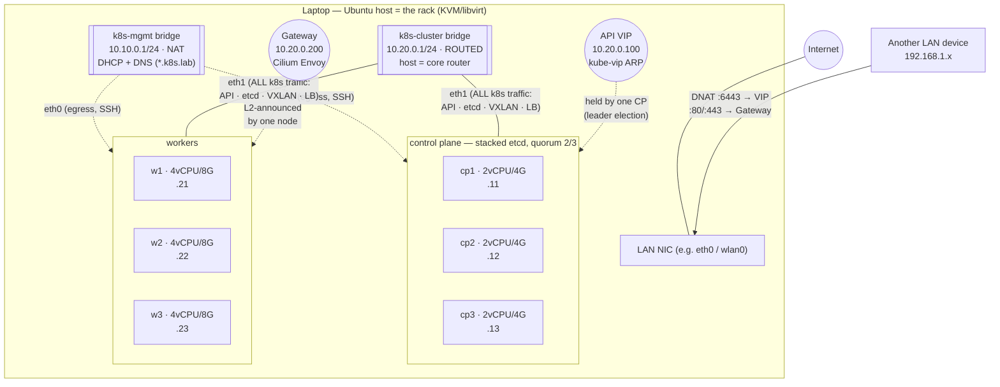

# baremetal-k8s-lab — production-grade on-prem Kubernetes, simulated on one host

A faithful simulation of a **bare-metal HA Kubernetes deployment**: the laptop
plays the rack, KVM VMs play the servers, libvirt networks play the switching
fabric — and everything above the hypervisor is **exactly** what you would run
on real on-prem hardware: kubeadm, containerd, kube-vip, Cilium (eBPF, no
kube-proxy), Gateway API, cert-manager PKI.

## Why this exists

Most Kubernetes learning happens on managed clouds (EKS/GKE/AKS) or
single-node toys (kind, minikube), where the hard parts are hidden: no
load balancer to provide, no VIP for the API server, no storage unless you
bring it, no registry, no PKI. On-prem you own all of it.

This lab builds the whole stack yourself, end to end, from VMs to an HA
control plane, networking, storage, registry, observability and a traced
demo app, with scripts you can read and docs that explain every decision.
Then you break it on purpose (kill a control plane, partition a node,
restore etcd, upgrade Kubernetes) and watch it recover. Good for CKA/CKS
prep, platform/SRE engineers heading to on-prem, or anyone who wants to
know what a managed cluster does for them.

## Requirements

| | Minimum | Notes |
|---|---|---|
| Host OS | **Ubuntu 24.04 LTS** (x86_64, bare metal) | scripts use `apt`; other Debian-based distros may work but aren't tested. **Not macOS/Windows** (needs KVM). A VM host only works with nested virtualization |
| CPU | **8+ cores / 16 threads** with VT-x or AMD-V enabled | 6 VMs = 18 vCPU, overcommit is fine; check with `egrep -c '(vmx\|svm)' /proc/cpuinfo` |
| RAM | **48 GiB** (64 GiB comfortable) | VMs take 36 GiB, the host needs the rest |
| Disk | **100 GiB free, SSD/NVMe** | thin disks: ~15 GiB after bring-up, grows with use (etcd and Longhorn dislike slow disks) |
| Network | internet access | image pulls, apt, Helm charts; LAN access is optional |
| Access | a sudo user | only `00-host-setup.sh` needs sudo |

Short on RAM? Shrink `CP_RAM_MB` / `W_RAM_MB` or drop a worker in
[config/lab.env](config/lab.env) **before** the first `labctl up`. Expect
to lose some observability/storage headroom.



## Quickstart

```bash
# 1) ONE-TIME, the only command that needs sudo (KVM, cockpit, client tools,
#    LAN DNAT, /etc/hosts). Idempotent.
sudo ./scripts/00-host-setup.sh

# 2) everything else — networks → VMs → HA cluster → Cilium → gateway → verify
./labctl up

# 3) look around
./labctl status
kubectl get nodes -o wide
k9s
curl http://hello.k8s.lab            # through the API gateway
```

Bring-up takes ~15–25 min (mostly image pulls). Stages are resumable — each
script is idempotent and `labctl up` skips what's already built.

## What you get

| Layer | Choice | Why (details in [docs/00-architecture.md](docs/00-architecture.md)) |
|---|---|---|
| Hypervisor | **KVM + libvirt** | the actual Linux on-prem virtualization stack |
| VM provisioning | **cloud-init + Ubuntu 24.04 cloud image** | the DC pattern (PXE/cloud-init), thin COW disks |
| K8s installer | **kubeadm** | the canonical way to learn real cluster bootstrap (what CKA tests, what kubespray wraps) |
| CRI | **containerd 2.x** | industry default (EKS/GKE/AKS), systemd cgroups |
| API HA | **kube-vip** (ARP, static pods) | modern replacement for haproxy+keepalived, no extra LB VMs |
| etcd | **stacked, 3 members** | standard kubeadm HA topology, quorum 2/3 |
| CNI | **Cilium** (eBPF) | VXLAN overlay, **kube-proxy fully replaced**, Hubble observability |
| LoadBalancer | **Cilium LB-IPAM + L2 announcements** | on-prem `type: LoadBalancer` without MetalLB |
| API gateway | **Gateway API + Cilium** | the successor of Ingress; one shared gateway, per-team HTTPRoutes |
| PKI / TLS | **cert-manager + lab CA** | wildcard `*.k8s.lab` cert on the gateway, real issuance flow |
| Storage | **Longhorn CSI** (default SC) + CSI snapshots | replicated block storage across workers, verified snapshot/restore; local-path kept for cache-tier PVCs |
| Registry | **private registry** (lab-CA TLS, own LB IP) | nodes trust the internal CA — the corporate-registry pattern; fed by `ko` builds |
| Demo system | **microshop** — 4 Go services + CNPG Postgres + Redis | fullstack OTel tracing: browser → gateway → services → SQL/cache ([apps/microshop](apps/microshop/)) |
| Metrics | **kube-prometheus-stack** (+ metrics-server) | Prometheus Operator, Alertmanager, Grafana — the k8s metrics standard; control-plane targets properly exposed |
| Logging | **Loki + Alloy** | the k8s-native log stack (Alloy = Promtail's successor); LogQL in Grafana |
| Tracing | **OpenTelemetry Collector + Tempo** | OTLP end-to-end, service graph fed back into Prometheus, TraceQL |
| Observability UIs | `grafana.` `prometheus.` `alertmanager.` `hubble.k8s.lab` | all through the shared Gateway; trace↔log↔metric correlation wired |
| VM management | **virt-manager, Cockpit (:9090), labctl, virsh** | GUI, web (LAN-reachable), CLI |
| K8s management | **kubectl, k9s, helm, cilium/hubble CLIs** | |

## Addressing (full plan: `./labctl ips`)

| What | Value |
|---|---|
| mgmt net (eth0) | `10.10.0.0/24` — NAT, DNS+DHCP, node octets .11-.13/.21-.23 |
| cluster net (eth1) | `10.20.0.0/24` — routed, same octets |
| API | `https://api.k8s.lab:6443` → VIP `10.20.0.100` |
| Gateway | `10.20.0.200` → `hello.k8s.lab`, `hubble.k8s.lab` |
| LB-IPAM pool | `10.20.0.200 – 10.20.0.239` |
| Pods / Services | `10.244.0.0/16` (VXLAN overlay) / `10.96.0.0/16` |

## Version policy

Control plane and CNI ride the **n-1 stable train** (what conservative prod
does): Kubernetes **v1.35** (upstream stable is 1.36) and Cilium **1.19.6**
(1.20.0 is a fresh `.0`). This is deliberate — upgrading to 1.36 **is one of
the lab exercises** ([docs/20-operations.md](docs/20-operations.md)). All pins
live in [config/lab.env](config/lab.env).

## Documentation

| Doc | Contents |
|---|---|
| [docs/00-architecture.md](docs/00-architecture.md) | design decisions + rationale, HA anatomy, bootstrap sequence |
| [docs/10-networking.md](docs/10-networking.md) | **the deep dive**: every layer from libvirt bridge to VXLAN to Gateway, with packet walks |
| [docs/20-operations.md](docs/20-operations.md) | lifecycle, snapshots, scaling, upgrades, etcd backup/restore, failure drills |
| [docs/30-access.md](docs/30-access.md) | local access + 3 ways in from the LAN, kubeconfigs, TLS trust, cockpit |
| [docs/40-troubleshooting.md](docs/40-troubleshooting.md) | layered diagnosis, command cookbook, known gotchas |
| [docs/50-observability.md](docs/50-observability.md) | the four-signal stack: Prometheus, Loki, Tempo, OTel, Hubble — queries, correlations, prod deltas |
| [docs/60-traffic-management.md](docs/60-traffic-management.md) | Gateway API L7 features, canary exercise, when a service mesh is worth it |
| [docs/15-storage-csi.md](docs/15-storage-csi.md) | Longhorn CSI, snapshot/restore, node-death drill, prod deltas |
| [docs/70-microshop-tracing.md](docs/70-microshop-tracing.md) | the fullstack traced demo: architecture, instrumentation tour, exercises |

## labctl cheat sheet

```text
./labctl up                     build everything        ./labctl status      overview
./labctl start | stop           ordered power control   ./labctl doctor      health + hints
./labctl ssh cp1 [cmd]          into a node             ./labctl console w1  serial console
./labctl snapshot create NAME   freeze all VMs          ./labctl reset       back to 'baseline'
./labctl etcd-backup            etcd snapshot           ./labctl ips         addressing table
./labctl sniff vxlan|arp|api    watch the wire          ./labctl expose off  kill LAN DNAT
./labctl kubeconfig             local + LAN kubeconfig  ./labctl destroy     delete VMs
```

## Repo layout

```text
labctl                  management CLI (VMs, network, cluster, snapshots)
config/lab.env          THE single source of truth (IPs, sizes, versions)
config/…                cloud-init / kubeadm / cilium templates
scripts/00-…70-…        numbered build stages (each idempotent, re-runnable)
scripts/node/prep.sh    what turns a stock Ubuntu server into a k8s node
manifests/              LB-IPAM, Gateway, PKI, demo app, hubble route
docs/                   the documentation set
.state/ .cache/ generated/   runtime artifacts (gitignored)
```

## Status

Built and verified on the reference host (2026-08-07): **20/20 checks pass** —
6/6 nodes Ready on Kubernetes v1.35.7, 3-member etcd, kube-proxy-free Cilium
1.19.6 with VXLAN, Gateway serving `hello.k8s.lab` over HTTP+HTTPS (lab CA),
`kubectl top` live, DNAT active. **HA failover drill: cp1 paused → API stayed
up via the VIP, ARP takeover in ≤19 s.** All-VM `baseline` snapshot taken —
`./labctl reset` returns to this exact state.

Observability verified same day: **0 down Prometheus targets** (incl. etcd ×3,
scheduler ×3, controller-manager ×3 on re-bound endpoints), ~13k log lines/10m
in Loki, real podinfo traces in Tempo via OTel (app → collector → backend →
Grafana correlation), service-graph metrics remote-written to Prometheus.

Storage + fullstack demo verified same day: **Longhorn CSI** default class
with a proven write→snapshot→restore loop; private registry with lab-CA TLS
trusted by all node containerds; **microshop** deployed via ko — a single
order request produced one 16-span trace across web → api → orders → catalog
including the SQL statements (otelpgx) and the Redis cache MISS→HIT pair
(redisotel). CNPG Postgres 2/2, Redis AOF on Longhorn.

## Host footprint

6 VMs = 18 vCPU / 36 GiB RAM (of 22 threads / 60 GiB) — the host desktop keeps
~24 GiB. Disks are thin: ~15 GiB after bring-up, growing with use. The lab
**starts with the host** (libvirt autostart; API ready ~1-2 min after boot,
VMs shut down cleanly on host shutdown) — toggle with `./labctl autostart off`.
