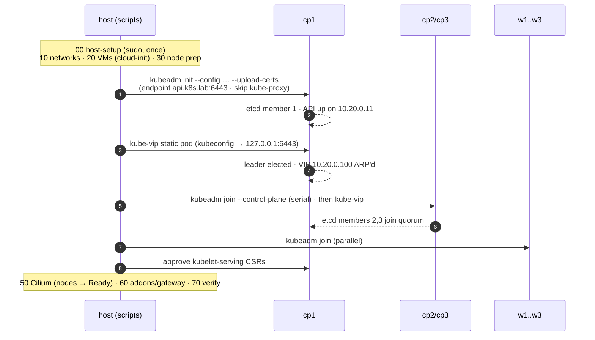
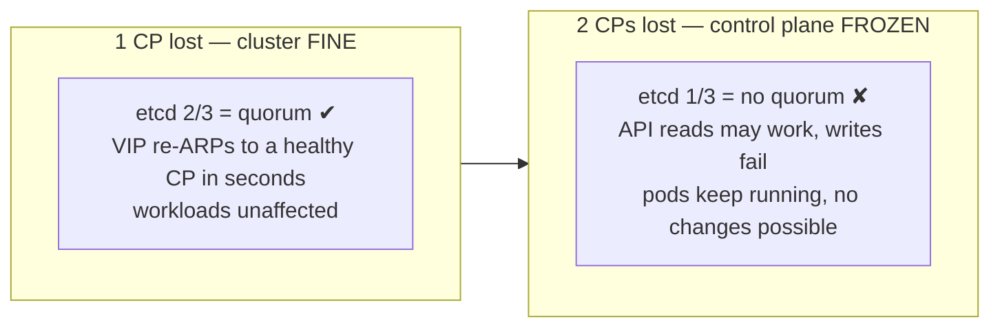

# Architecture

## The simulation contract

Everything **below** the VM boundary is simulation; everything **above** it is
the real thing. Skills practiced here transfer 1:1 to physical racks.

| Real datacenter | In this lab |
|---|---|
| Rack + chassis | the laptop |
| Bare-metal servers | KVM/QEMU VMs (`k8s-cp1..3`, `k8s-w1..3`) |
| ToR management switch + OOB network | libvirt NAT network `k8s-mgmt` (10.10.0.0/24) |
| ToR data switch / L3 fabric | libvirt **routed** network `k8s-cluster` (10.20.0.0/24) |
| PXE + preseed provisioning | Ubuntu cloud image + cloud-init NoCloud seed |
| DC DNS zone | libvirt dnsmasq (`*.k8s.lab`) + static `/etc/hosts` |
| Edge firewall / NAT | nftables DNAT on the laptop's LAN NIC |
| Remote hands / IPMI console | `labctl console <node>` (serial), virt-manager, Cockpit |

## Design decisions and why

### kubeadm (vs k3s, RKE2, kubespray)
`kubeadm` is the **canonical bootstrap tool**: you see every moving part
(certs, etcd, static pods, join tokens) instead of a black box. k3s/RKE2 are
excellent products but hide exactly the machinery this lab exists to teach;
kubespray is Ansible **around kubeadm** — learn the core first, automate later.
It's also what the CKA/CKS exams and most bare-metal docs assume.

### containerd (vs CRI-O, Docker)
containerd is the default CRI of EKS/GKE/AKS and the k8s ecosystem's
reference runtime. We take containerd 2.x from Docker's apt repo (Ubuntu's
archive lags) and set `SystemdCgroup = true` — kubelet and runtime **must**
agree on the cgroup driver (cgroup v2 + systemd is the modern standard).

### kube-vip (vs HAProxy + keepalived pair)
The classic pattern needs two extra LB VMs. kube-vip runs as a **static pod on
each control plane**, elects a leader, and ARPs the VIP (`10.20.0.100`) on the
cluster network — same VRRP-style failover semantics, zero extra machines.
This is today's recommended kubeadm HA companion. The API endpoint everywhere
(kubeconfigs, kubelets, join configs) is the VIP name `api.k8s.lab`, never an
individual node.

### Stacked etcd (vs external etcd)
Each control plane runs its own etcd member co-located with the API server —
the standard kubeadm HA topology. 3 members ⇒ quorum 2 ⇒ **one CP can die**
with zero impact. External etcd (separate 3-VM cluster) buys you independent
failure domains at 2× the machines — documented as a variant, not built.

### Cilium (vs Calico/Flannel) — and no kube-proxy
eBPF datapath, VXLAN overlay, **full kube-proxy replacement** (kubeadm runs
with `skipPhases: addon/kube-proxy`), Hubble flow observability, LB-IPAM + L2
announcements (kills the MetalLB dependency), and a native **Gateway API**
implementation (kills the ingress-controller dependency). One CNI provides
what would otherwise be four separate components. See
[10-networking.md](10-networking.md) for the full datapath story.

### Gateway API (vs Ingress)
Ingress is frozen; Gateway API is its GA successor. The lab models the prod
pattern: **one shared Gateway** (`infra` namespace, wildcard TLS from the lab
CA) and per-app `HTTPRoute`s attached cross-namespace.

## Node layout

| Node | Role | vCPU | RAM | Disk | mgmt (eth0) | cluster (eth1) |
|---|---|---|---|---|---|---|
| cp1 | control-plane, etcd | 2 | 4 GiB | 30 G | 10.10.0.11 | 10.20.0.11 |
| cp2 | control-plane, etcd | 2 | 4 GiB | 30 G | 10.10.0.12 | 10.20.0.12 |
| cp3 | control-plane, etcd | 2 | 4 GiB | 30 G | 10.10.0.13 | 10.20.0.13 |
| w1–w3 | workers | 4 | 8 GiB | 60 G | 10.10.0.21-23 | 10.20.0.21-23 |

Control planes keep their `NoSchedule` taint (prod practice) — workloads live
on workers. Disks are copy-on-write overlays on one shared base image.

## Bootstrap sequence

Two bootstrap subtleties worth knowing (they bite on real racks too):

1. **kube-vip chicken-and-egg**: kube-vip's leader election needs the API,
   but `admin.conf` points at the VIP — the very address kube-vip exists to
   create. Deadlock (we hit it live: `no route to host` on the lease, forever).
   Fix: each CP runs kube-vip against its **local** apiserver via a derived
   kubeconfig (`server: https://127.0.0.1:6443` — 127.0.0.1 is in the cert
   SANs), placed after init/join — [scripts/40-init-cluster.sh](../scripts/40-init-cluster.sh).
2. **kubelet serving certs**: we set `serverTLSBootstrap: true` (the *correct*
   way to let metrics-server verify kubelets). Serving CSRs are not
   auto-approved by design — bootstrap approves them, and rotations need
   `./labctl approve-certs` (or install `kubelet-csr-approver` to automate).

## HA anatomy — what dies when

Drill it live: `./scripts/70-verify.sh --failover` pauses cp1 and measures the
VIP failover. More drills in [20-operations.md](20-operations.md).

## Version policy

Pins live in [config/lab.env](../config/lab.env): Kubernetes **v1.35** train +
Cilium **1.19.6** — deliberately **n-1** (prod discipline: never ride `.0` of
the newest minor). Upgrading to 1.36 is a first-class exercise in
[20-operations.md](20-operations.md). Companion pins: Gateway API `v1.4.1`
(exactly what Cilium 1.19 supports), kube-vip `v1.2.2`, cert-manager
`v1.21.1`, Ubuntu **24.04 LTS** cloud image for nodes (the battle-tested LTS).
