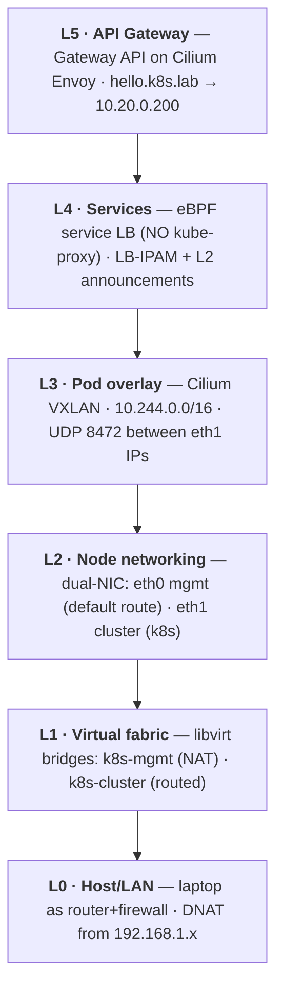
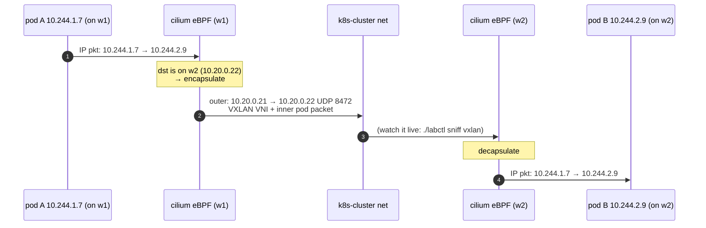
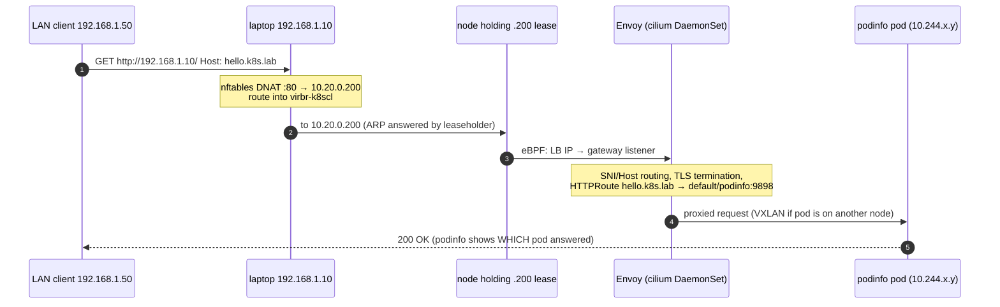

# Networking deep dive

Six layers, bottom-up — each with its own failure modes and its own tools.



## L1 — the virtual fabric (libvirt)

Two bridges = two "switches", mirroring the mgmt/data separation of real DCs:

| | `k8s-mgmt` (virbr-k8smg) | `k8s-cluster` (virbr-k8scl) |
|---|---|---|
| CIDR | 10.10.0.0/24 (host .1) | 10.20.0.0/24 (host .1) |
| Mode | **NAT** — VMs reach the internet | **routed** — no NAT, host = core router |
| Services | dnsmasq: DHCP (.150+) + DNS `*.k8s.lab` | none (static IPs only) |
| Carries | SSH, apt, image pulls | API, etcd, VXLAN, LB/VIP — *everything k8s* |

Why **routed** (not NAT) for the cluster net: NAT would hide node/VIP/LB IPs
behind the host. Routed means `10.20.0.0/24` is a *real* subnet the host
routes into — so the host, and any LAN device with a route (or via DNAT),
reaches VIPs directly. That's exactly how a DC L3 fabric behaves.
Consequence: cluster-net has no internet egress — which is why nodes
default-route via eth0. Inspect: `virsh net-dumpxml k8s-cluster`, `ip route`.

## L2 — node networking

Every node is dual-homed with **deterministic MACs** (`52:54:00:10:00:xx` mgmt,
`52:54:00:20:00:xx` cluster; xx = IP octet in hex) so netplan matches by MAC:

```text
eth0  10.10.0.x/24   default route via 10.10.0.1, DNS 10.10.0.1   ← egress/SSH
eth1  10.20.0.x/24   NO gateway                                   ← all k8s traffic
```

The kubelet is *pinned* to the cluster net with `--node-ip` (see the
`kubeletExtraArgs` in [config/kubeadm/](../config/kubeadm/)) and the API
advertises on eth1 — otherwise Kubernetes would happily register the mgmt IPs
and your "data plane separation" would be fiction. Verify:
`kubectl get nodes -o wide` → INTERNAL-IP must be `10.20.0.x`.

## L3 — pod networking: the VXLAN overlay

Pods get IPs from `10.244.0.0/16` (Cilium cluster-pool IPAM, one `/24` per
node). Cross-node pod traffic is **VXLAN-encapsulated**: the original pod
packet becomes the payload of a UDP:8472 packet between node eth1 IPs.



**Why overlay?** The fabric only needs to route node IPs — pod CIDRs never
touch the switches. That's the operational win (and cost: 50 bytes of
encapsulation ⇒ pod MTU **1450** on a 1500 fabric — Cilium sets this
automatically; on real hardware you'd run jumbo frames instead). The
alternative — *native routing + BGP to the fabric* — is faster and is the
suggested next exercise (Cilium BGP control plane + FRR on the host bridge).

Egress to the internet: pod → iptables masquerade → **eth0** (mgmt NAT).
We deliberately use iptables masquerade (`bpf.masquerade: false`) because
egress leaves a *different* NIC than the k8s datapath NIC.

Watch it:

```bash
./labctl sniff vxlan                       # raw encapsulated frames on the bridge
hubble observe --namespace default -f     # the same flows, decoded, L7-aware
kubectl -n kube-system exec ds/cilium -- cilium-dbg status | grep -i tunnel
```

## L4 — services without kube-proxy

kube-proxy was **never installed** (`skipPhases: addon/kube-proxy`). Cilium's
eBPF replaces it: ClusterIP resolution happens at the socket layer on the
source node (connect() is rewritten to the backend IP — no per-packet DNAT,
no iptables chains), NodePort/LB handled by XDP/tc programs on `eth0/eth1`.
Compare mentally with the iptables mode you'd get on a legacy cluster:
O(1) eBPF map lookup vs O(n) rule traversal.

`type: LoadBalancer` on-prem needs two things a cloud gives you for free:

1. **an IP** → `CiliumLoadBalancerIPPool` `10.20.0.200-239` (LB-IPAM)
2. **reachability** → `CiliumL2AnnouncementPolicy`: one agent per service
   wins a lease and answers **ARP** for that IP on `eth1` — same mechanism as
   keepalived/MetalLB-L2. Failover = lease expiry + gratuitous ARP.

```bash
./labctl sniff arp        # watch who-has 10.20.0.200 → reply from the leaseholder
kubectl -n kube-system get lease | grep l2announce
```

## L5 — the API gateway (end-to-end packet walk)

One shared `Gateway` (`infra/lab-gateway`, class `cilium`) at pinned
`10.20.0.200`, wildcard TLS `*.k8s.lab` from the lab CA; apps attach
`HTTPRoute`s from their own namespaces. Full path of a request from another
device on your LAN:



## DNS — three planes

| Plane | Server | Serves |
|---|---|---|
| Cluster (pods) | CoreDNS (`10.96.0.10`) | `*.svc.cluster.local`, forwards the rest |
| Lab (VMs) | libvirt dnsmasq on `10.10.0.1` | `*.k8s.lab` (+ `/etc/hosts` on nodes as belt-and-braces) |
| Host + LAN | host `/etc/hosts` (written by 00-host-setup) | `api.k8s.lab`, `hello.k8s.lab`, … |

## Where to go next (exercises)

1. **BGP instead of L2/VXLAN**: enable Cilium's BGP control plane, peer with
   FRR on the host — advertise pod CIDRs and LB IPs like a real leaf-spine.
2. **Network policy**: default-deny the `default` namespace, then allow
   gateway→podinfo with a `CiliumNetworkPolicy`; watch drops in Hubble.
3. **Native routing mode**: `routingMode: native` + `autoDirectNodeRoutes` —
   measure VXLAN vs native throughput with iperf3 between pods.
4. **Dual-stack**: add IPv6 ULA prefixes to the cluster net and pod CIDR.
