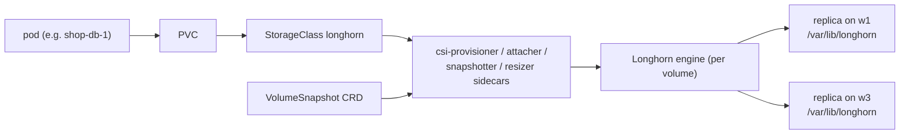

# Storage & CSI

Two provisioners live in this cluster — deliberately, so you learn both ends
of the spectrum:

| | **Longhorn** (default since stage 90) | local-path (stage 60) |
|---|---|---|
| What it is | real **CSI driver**: distributed, replicated block storage | hostPath-based dynamic provisioner |
| Data location | 2 replicas on different workers (`/var/lib/longhorn`) | one directory on one node |
| Node dies | volume keeps serving from the other replica, rebuilds later | data gone with the node |
| Snapshots/clones | ✔ CSI VolumeSnapshot (+ Longhorn's own snaps/backups) | ✘ |
| Expansion | ✔ online | ✘ |
| Used by | registry, Postgres (CNPG), Redis, anything new | the observability PVCs (predate Longhorn; fine for cache-like data) |



## What "CSI well configured" means here (all verified by `scripts/90-storage.sh`)

1. **Driver + sidecars**: `kubectl get csidriver` → `driver.longhorn.io`;
   provisioning/attach/detach happen over iSCSI (open-iscsi installed on all
   nodes by the script).
2. **Exactly one default StorageClass**: `longhorn` (local-path demoted) —
   `kubectl get sc`.
3. **Snapshot machinery installed**: kubeadm clusters ship *neither* the
   `VolumeSnapshot` CRDs *nor* the snapshot-controller — stage 90 installs
   both (kubernetes-csi external-snapshotter) plus a default
   `VolumeSnapshotClass`. Without this, `kubectl apply` of a VolumeSnapshot
   silently does nothing on most self-managed clusters.
4. **Proven end-to-end**: the script provisions a PVC, writes a marker,
   snapshots it, restores the snapshot into a *new* PVC and reads the marker
   back. That loop — not "the PVC bound" — is what *persist* means.

## Operations you should practice

```bash
# UI (volume topology, rebuild status, snapshots):
kubectl -n longhorn-system port-forward svc/longhorn-frontend 8081:80   # -> http://localhost:8081

# snapshot a database volume (app-consistent: CNPG does this properly via
# its backup API; crash-consistent is fine for the drill):
kubectl -n microshop get pvc                     # find the shop-db PVC
kubectl -n microshop apply -f - <<'EOF'
apiVersion: snapshot.storage.k8s.io/v1
kind: VolumeSnapshot
metadata: { name: shop-db-manual }
spec: { source: { persistentVolumeClaimName: <pvc-name> } }
EOF

# THE drill — kill a worker holding a replica, watch data survive:
virsh -c qemu:///system destroy k8s-w2
kubectl -n microshop exec shop-db-1 -- psql -U postgres -c 'select count(*) from orders'  # still answers
./labctl start                                   # w2 returns, Longhorn rebuilds the replica
```

## Prod deltas

- Longhorn replica count 2 → **3** on real clusters; dedicated storage NICs
  and SSD-only disks (`node.longhorn.io/create-default-disk`).
- Backups: Longhorn backup target (NFS/S3/MinIO) for off-cluster copies —
  snapshots alone die with the cluster.
- Databases: CNPG adds *application-consistent* backups (barman, WAL
  archiving to object storage) on top of block-level snapshots — use both.
- Alternatives by scale: OpenEBS Mayastor (NVMe-oF performance),
  Rook-Ceph (large clusters, also object+file), vendor CSI (SAN arrays).
