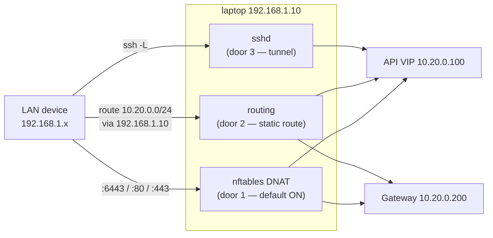

# Access — local and over the LAN

## From the laptop

| What | How |
|---|---|
| kubectl | `~/.kube/config` → `https://api.k8s.lab:6443` (the VIP — works while any 1 CP lives) |
| TUI | `k9s` |
| Node SSH | `./labctl ssh cp1` (key `~/.ssh/k8s-lab`, user `ops`, via mgmt net) |
| Serial console | `./labctl console w1` — exit with `Ctrl+]` (the "IPMI SOL" of the lab) |
| VM GUI | `virt-manager` (needs one log-out/in after host-setup for the libvirt group) |
| VM web UI | Cockpit → `https://localhost:9090` → *Virtual machines* (login = your Linux user) |
| Demo app | `curl http://hello.k8s.lab` / browser (host `/etc/hosts` already points at the gateway) |
| Hubble UI | `http://hubble.k8s.lab` — live service map & flows |
| Grafana | `https://grafana.k8s.lab` — `admin` / `cat .state/grafana-admin.pass` |
| Prometheus / Alertmanager | `http://prometheus.k8s.lab` · `http://alertmanager.k8s.lab` |
| Hubble CLI | `cilium hubble port-forward &` then `hubble observe -f` |

## From another device on your LAN

Three doors, in order of effort. Examples below use `192.168.1.10` as the host's LAN IP; substitute yours (`ip -4 route get 1.1.1.1`).



### Door 1 — DNAT (zero client config, on by default)

`00-host-setup` installed nftables rules on the laptop's LAN interface:
`:6443 → VIP`, `:80/:443 → Gateway`. From any LAN device:

```bash
curl -k https://192.168.1.10:6443/version          # API server
curl -H 'Host: hello.k8s.lab' http://192.168.1.10/ # through the gateway
```

For nice hostnames on that device, add to **its** hosts file:
`192.168.1.10 api.k8s.lab hello.k8s.lab hubble.k8s.lab`.
Toggle: `./labctl expose off|on|status`.

### Door 2 — a static route (the "real network" way)

Teach your LAN that the cluster subnet lives behind the laptop — on the other
device (or once, on your home router):

```bash
sudo ip route add 10.20.0.0/24 via 192.168.1.10    # Linux/macOS client
```

Now the device reaches node IPs, the VIP and every LB IP *directly* — no NAT,
real routing, exactly like an office network reaching a server VLAN. Caveat:
many Wi-Fi APs enable *client isolation*, which silently blocks
device-to-laptop traffic — if door 2 fails but door 1 works, that's why.

### Door 3 — SSH tunnel (works from anywhere you can ssh)

```bash
ssh -L 6443:10.20.0.100:6443 user@192.168.1.10
kubectl --server https://127.0.0.1:6443 ... # with the lab kubeconfig
```

### kubeconfig for remote devices

```bash
./labctl kubeconfig      # writes .state/kubeconfig-lan.yaml (server = LAN IP)
```

The API cert already contains the LAN IP in its SANs (added at init), so TLS
verifies cleanly. If your DHCP address changes, see the SAN procedure in
[20-operations.md](20-operations.md).

### Cockpit from the LAN

`https://192.168.1.10:9090` — full web management of the VMs (console,
start/stop, resources) from any browser on your network.

## TLS trust for `https://*.k8s.lab`

The gateway serves a wildcard cert issued by the lab's own CA
(cert-manager). Trust it per-client:

```bash
curl --cacert .state/lab-ca.crt https://hello.k8s.lab/
# Firefox/Chrome: Settings → Certificates → Authorities → import lab-ca.crt
# Debian/Ubuntu system-wide:
sudo cp .state/lab-ca.crt /usr/local/share/ca-certificates/k8s-lab-ca.crt && sudo update-ca-certificates
```

## Security notes (it's a lab, but be deliberate)

- The DNAT door exposes your **cluster admin API to the whole LAN** —
  protected only by client-cert auth in the kubeconfig. Fine at home; on a
  shared/office LAN run `./labctl expose off` and use door 3.
- `~/.kube/config` and `.state/kubeconfig-lan.yaml` are **cluster root**.
  `.state/` is chmod-tight and gitignored — keep it that way.
- The lab CA only signs `*.k8s.lab`; still, prefer per-browser import over
  system-wide trust on machines you care about.
