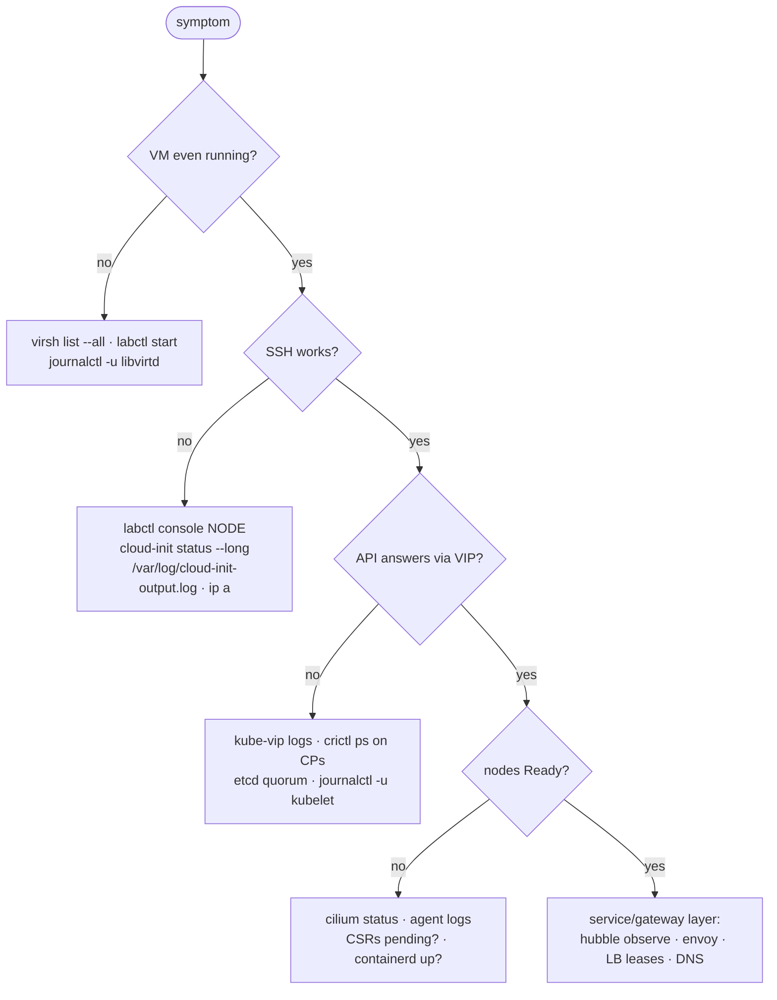

# Troubleshooting

Start with `./labctl doctor` — it walks the stack bottom-up and prints fix
hints. When you need to dig, diagnose **by layer**:



## Command cookbook by layer

**VM / libvirt** (all wrapped by `labctl`):

```bash
virsh -c qemu:///system list --all               # states
./labctl console cp1                             # serial console (Ctrl+] exits)
./labctl ssh cp1 "cloud-init status --long"      # first-boot provisioning result
sudo journalctl -u libvirtd -e                   # hypervisor side
```

**Node / kubelet / containerd**:

```bash
./labctl ssh cp1 "sudo journalctl -u kubelet -e --no-pager | tail -50"
./labctl ssh cp1 "sudo crictl ps -a"             # static pods live here even when API is down
./labctl ssh cp1 "sudo crictl logs <id>"
./labctl ssh cp1 "systemctl status containerd"
```

**Control plane / HA**:

```bash
./labctl ssh cp1 "sudo crictl ps --name kube-vip -a"       # VIP holder health
ip neigh show 10.20.0.100                                  # which MAC owns the VIP now
kubectl -n kube-system get pods -l tier=control-plane -o wide
kubectl -n kube-system exec etcd-cp1 -- etcdctl \
  --cacert /etc/kubernetes/pki/etcd/ca.crt \
  --cert /etc/kubernetes/pki/etcd/server.crt \
  --key /etc/kubernetes/pki/etcd/server.key endpoint status --cluster -w table
```

**Cilium / pods / services**:

```bash
cilium status                                     # the one-glance CNI health
kubectl -n kube-system exec ds/cilium -c cilium-agent -- cilium-dbg status --verbose
hubble observe -f --verdict DROPPED               # what is being dropped, and why
cilium connectivity test                          # the full official test suite (~10 min)
kubectl -n kube-system get lease | grep l2announce  # who announces which LB IP
```

**Gateway**:

```bash
kubectl -n infra describe gateway lab-gateway     # conditions tell the story
kubectl get httproute -A
kubectl -n infra get certificate                  # wildcard cert Ready?
curl -v --resolve hello.k8s.lab:80:10.20.0.200 http://hello.k8s.lab/
```

## Known gotchas (each one is a lesson)

| Symptom | Cause | Fix |
|---|---|---|
| `virsh: permission denied` right after setup | group membership needs re-login | scripts handle it via `sg libvirt`; log out/in for GUI tools |
| VIP never appears; kube-vip logs `no route to host` on the lease | its election client pointed at the VIP itself (chicken-and-egg) | we aim it at `127.0.0.1:6443` via `/etc/kubernetes/kube-vip.kubeconfig` — see 40-init script |
| `kubeadm join: token expired` | tokens live 2h | `./labctl ssh cp1 "sudo kubeadm token create --print-join-command"` |
| `kubectl top` errors / metrics-server TLS | kubelet serving CSR pending (rotates ~monthly!) | `./labctl approve-certs` |
| Node NotReady, `cni plugin not initialized` | Cilium agent not up on that node | `kubectl -n kube-system get pods -l k8s-app=cilium -o wide`, agent logs |
| Small requests OK, big transfers hang | MTU: something clamped below VXLAN's 1450 | `cilium-dbg status | grep MTU`; don't lower bridge MTU |
| LAN device can't reach anything | Wi-Fi AP client isolation, or DNAT off | test from the host first; `./labctl expose status`; try door 3 (SSH tunnel) |
| TLS error connecting API via LAN IP | laptop got a new DHCP address (not in SANs) | SAN update procedure in [20-operations.md](20-operations.md), or SSH tunnel |
| Whole lab wedged after laptop suspend | VM clocks drifted (etcd/TLS hate that) | `./labctl restart` (VMs resync via systemd-timesyncd on boot) |
| API slow/failing with 1 CP down | that's *normal* only for 2 CPs down (no quorum) | resume a CP; see HA anatomy in [00-architecture.md](00-architecture.md) |

## Where logs live

| What | Where |
|---|---|
| cloud-init (per VM) | `/var/log/cloud-init-output.log` on the node |
| kubeadm init/join | `.state/logs/` on the host (host-side capture) |
| static pods (apiserver, etcd, kube-vip) | `sudo crictl logs …` on the CP — works API-down |
| lab build stages | `.state/logs/<stage>-<node>.log` |
| libvirt / qemu | `journalctl -u libvirtd`, `/var/log/libvirt/qemu/k8s-*.log` |

## Escalation ladder

1. `./labctl doctor` → targeted fix
2. `./labctl restart` (clean ordered reboot of the lab)
3. `./labctl reset` (revert every VM to the `baseline` snapshot)
4. `./labctl destroy && ./labctl up` (15-min full rebuild — this is a lab;
   rebuilding *is* the skill)
