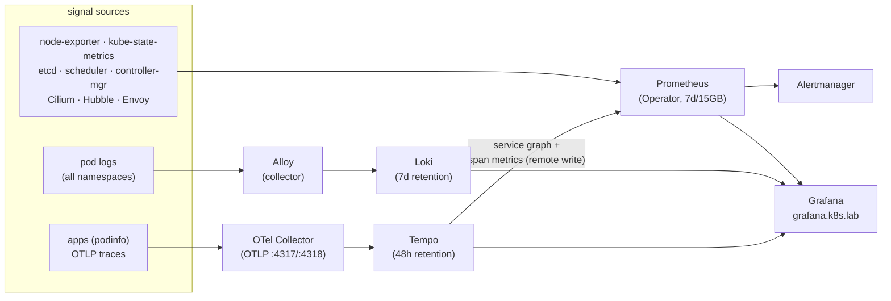

# Observability

The lab runs the full modern on-prem observability architecture — the four
signals (metrics, logs, traces, network flows), one query surface (Grafana),
everything OTLP/Prometheus-native. Installed by
[scripts/80-observability.sh](../scripts/80-observability.sh) into the
`observability` namespace.



## The components and why each one

| Signal | Tool | Why it's the prod choice |
|---|---|---|
| Metrics | **kube-prometheus-stack** (Prometheus Operator + Alertmanager + Grafana + node-exporter + kube-state-metrics) | *the* Kubernetes metrics standard; CRD-driven scrape config (`ServiceMonitor`), ~30 curated dashboards + a full production alert-rule set out of the box |
| Logs | **Loki** + **Alloy** collector | the k8s-native logging standard: indexes labels not content → cheap at scale, LogQL mirrors PromQL, first-class in Grafana. Alloy is Promtail's successor (Promtail is EOL since March 2026). The alternative (Elastic/OpenSearch + Fluent Bit) buys full-text search at ~5-10× the resource cost |
| Traces | **OpenTelemetry Collector** → **Tempo** | OTLP is *the* telemetry protocol (Jaeger v2 is itself OTel-based now); apps ship spans to the collector (batching, memory limits, later: sampling), Tempo stores them, TraceQL queries them. Tempo's metrics-generator remote-writes RED metrics + the **service graph** into Prometheus |
| Network | **Hubble** (already in Cilium) + Cilium/Envoy metrics | flow-level network observability no sidecar mesh can match — now scraped into Prometheus via ServiceMonitors |
| Alerting | **Alertmanager** | ships with the prod default rule set (etcd quorum, node pressure, cert expiry, crashloops…); routing/receivers are your exercise below |

## Access

| What | Where | Credentials |
|---|---|---|
| Grafana | `https://grafana.k8s.lab` | `admin` / `cat .state/grafana-admin.pass` |
| Prometheus UI | `http://prometheus.k8s.lab` (targets page = your scrape health) | — |
| Alertmanager | `http://alertmanager.k8s.lab` | — |
| Hubble UI | `http://hubble.k8s.lab` | — |

All flow through the shared Gateway at `10.20.0.200` — from another LAN device,
point these names at `192.168.1.10` in its hosts file.

## The control-plane instrumentation (a real kubeadm skill)

kubeadm binds etcd metrics (`:2381`), scheduler (`:10259`) and
controller-manager (`:10257`) to `127.0.0.1` — invisible to Prometheus. The
install script re-binds them to `0.0.0.0` in the static-pod manifests
(serially, health-checking each control plane). That's why the
`kube-etcd` / `kube-scheduler` / `kube-controller-manager` targets are **green**
here while they're ▼down on most tutorial clusters. Acceptable because the
cluster network is private; real prod adds firewall rules or an mTLS proxy in
front. (`kube-proxy` monitoring is disabled — there *is* no kube-proxy.)

## First queries — one per signal

```text
PromQL   (Grafana Explore → Prometheus)
  sum(rate(container_cpu_usage_seconds_total{namespace="default"}[5m])) by (pod)
  histogram_quantile(0.99, sum(rate(hubble_http_request_duration_seconds_bucket[5m])) by (le))

LogQL    (Explore → Loki)
  {namespace="default", app="podinfo"} |= "error"
  sum by (namespace) (rate({namespace=~".+"}[5m]))          # log volume per ns

TraceQL  (Explore → Tempo)
  { resource.service.name = "podinfo" && duration > 50ms }
```

Generate traffic first: `for i in $(seq 200); do curl -s http://hello.k8s.lab/ >/dev/null; done`

**The correlation loop to practice** (this is the senior workflow): RED
dashboard shows latency → Tempo service graph pinpoints the slow hop → open a
slow trace → *trace-to-logs* button jumps to that pod's logs at that moment →
logs contain the TraceID → click it to jump back. Wired via the datasource
config in [config/observability/kube-prometheus-stack-values.yaml.tpl](../config/observability/kube-prometheus-stack-values.yaml.tpl).

## Alerting exercise

Rules already fire (check `http://alertmanager.k8s.lab` — `Watchdog` is always
active as a dead-man's switch). Wire a receiver: put a Slack webhook or
`https://webhook.site` URL into an `alertmanagerConfiguration`, then trigger a
real alert: `virsh suspend k8s-w3` → wait for `KubeNodeNotReady` to route.

## Lab sizing vs real prod (be able to say this in an interview)

| Here (1 laptop) | Real on-prem prod |
|---|---|
| Prometheus ×1, 7d, local-path PV | ×2 replicas + **Thanos/Mimir** for HA + years of retention on object storage |
| Loki single-binary, filesystem | SimpleScalable/distributed over **S3/MinIO**, Alloy as clustered DaemonSet tailing `/var/log/pods` |
| Tempo monolithic, 48h | distributed over object storage, **tail-based sampling** in the OTel Collector |
| Alertmanager ×1, no receivers | ×3 gossip cluster → PagerDuty/Slack, on-call rotations |
| dashboards + default rules | + **SLOs with error budgets** (Sloth/Pyrra), runbook links in annotations |

Also worth knowing: **Pyroscope** (continuous profiling — the "fourth signal")
and **kubernetes-event-exporter** slot into this same stack; both are
one-helm-install exercises.

## Installed versions (2026-08-07)

| Release | Chart | App |
|---|---|---|
| kps (kube-prometheus-stack) | 88.1.5 | Prometheus Operator v0.93.0 |
| loki | 7.2.0 | Loki 3.6.11 |
| alloy | 1.11.0 | Alloy v1.18.0 |
| tempo | 1.24.4 | Tempo 2.9.0 |
| otel-collector | 0.168.0 | Collector 0.157.0 |

## Operations

- Disk: PVs live on the workers via local-path (`kubectl -n observability get pvc`).
  Retention caps: Prometheus 7d/15GB, Loki 7d, Tempo 48h — tune in
  [config/observability/](../config/observability/) and `helm upgrade`.
- All scrape configs are CRDs: `kubectl get servicemonitor -A` is your scrape
  inventory; the Prometheus *targets* page is its health.
- Everything re-applies with `./scripts/80-observability.sh` (idempotent).
