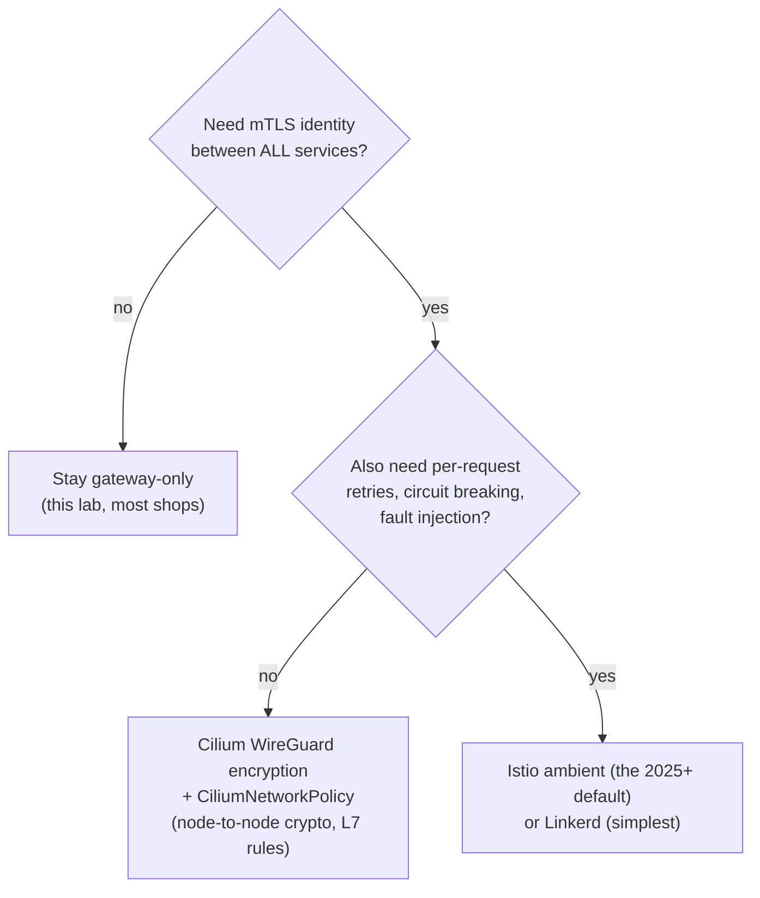

# Traffic management

Short version: **for north-south traffic you are already running the current
best practice** — Gateway API implemented by Cilium's per-node Envoy. What
most people haven't done is *use* its L7 features. This doc is that, plus an
honest map of when you'd add a service mesh.

## What the lab already gives you

| Capability | Where |
|---|---|
| L7 HTTP routing (host/path/header) | `HTTPRoute` on the shared Gateway |
| Wildcard TLS termination | Gateway `https` listener + cert-manager |
| **Weighted traffic split / canary** | `backendRefs[].weight` (exercise below) |
| Request timeouts | `rules[].timeouts` (GA in Gateway API 1.4) |
| Header rewrite / redirect / mirror | `rules[].filters` |
| L3/L4 LB + kube-proxy-free datapath | Cilium eBPF + LB-IPAM/L2 |
| Network policy (L3-L7!) | `CiliumNetworkPolicy` — can match HTTP method/path |

## Exercise 1 — canary release (weighted routing)

```bash
kubectl apply -f manifests/demo-canary.yaml     # adds canary + 90/10 split
for i in $(seq 1 30); do curl -s http://hello.k8s.lab/ | jq -r .hostname; done | sort | uniq -c
#   ~27 podinfo-…           <- stable
#   ~3  podinfo-canary-…    <- canary (yellow UI, "CANARY build")
```

Promote by editing the weights in the `hello` HTTPRoute (90/10 → 50/50 →
0/100), watching error rate per backend in Grafana as you go — that's a real
progressive delivery, done with nothing but the gateway. Roll back:
`kubectl apply -f generated/demo-podinfo.yaml`. (Automating exactly this loop —
metric-gated weight shifting — is **Flagger** or **Argo Rollouts**; both drive
Gateway API and make an excellent next exercise.)

## Exercise 2 — timeouts and header manipulation

```yaml
# add to a rule in the hello HTTPRoute:
timeouts:
  request: 2s                     # gateway-enforced budget
filters:
  - type: ResponseHeaderModifier
    responseHeaderModifier:
      add: [{ name: x-served-via, value: cilium-gateway }]
```

Test the timeout against podinfo's built-in delay endpoint:
`curl -s "http://hello.k8s.lab/delay/5"` → the gateway cuts it at 2s (504).

## Exercise 3 — L7 network policy (mesh-grade control, no mesh)

Cilium policies understand HTTP — allow only `GET /` from the gateway's Envoy
to podinfo and watch anything else get denied in `hubble observe
--verdict DROPPED`. Start from the recipe in
[10-networking.md](10-networking.md) exercises.

## Do you need a service mesh?



- **Cilium-native** (this lab): eBPF LB + Gateway API + L7 policy. Add
  transparent **WireGuard encryption** with two values
  (`encryption.enabled=true, encryption.type=wireguard`) + agent rollout —
  worthwhile on-prem exercise, snapshot first.
- **Istio ambient**: sidecar-less mesh (ztunnel DaemonSet + waypoint Envoys) —
  the modern prod mesh choice. Note: co-installing with Cilium's kube-proxy
  replacement has documented caveats (`cni.exclusive=false`, ztunnel
  interactions) — treat it as its own lab on a `baseline` snapshot.
- **Linkerd**: the lightweight sidecar mesh — simplest mTLS story, smaller
  feature set.

Senior take: gateway + Cilium policy covers most real on-prem platforms;
meshes earn their complexity at many-team scale or under strict zero-trust
compliance. Learn Istio *after* you can articulate what the gateway can't do.
