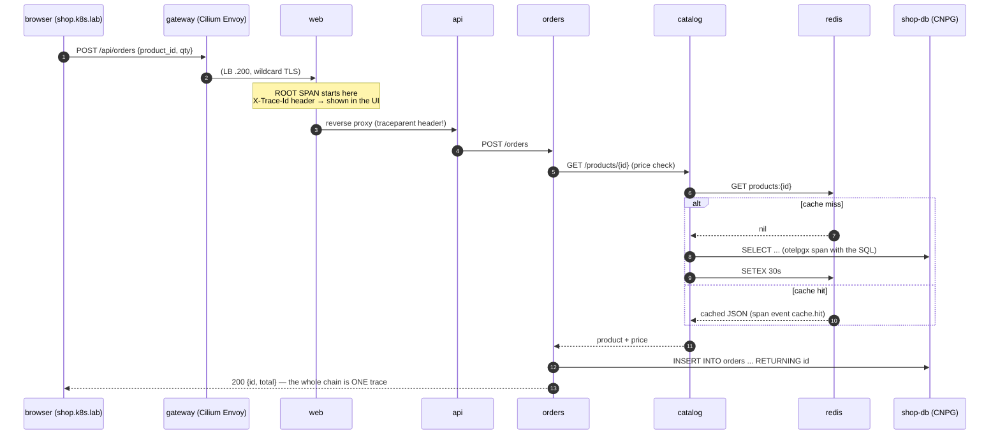

# microshop — fullstack tracing walkthrough

A real multi-tier system ([apps/microshop/](../apps/microshop/)) built to make
distributed tracing *tangible*: browser → LB/gateway → 4 Go services →
Postgres + Redis, one trace per user action, logs and metrics correlated.



## Use it

UI: `http://shop.k8s.lab` — every click shows its **trace id**; paste it into
Grafana → Explore → **Tempo**. Buy something (deep trace, DB writes), let the
30s cache TTL lapse and compare a **HIT vs MISS** products trace, then hit
**💥 trigger a failing order** and find the red trace
(`{ status = error }` in TraceQL, or Search → Status: error).

```text
TraceQL starters:
  { resource.service.name = "orders" && duration > 20ms }
  { name =~ "INSERT.*" }                        # find the SQL spans
  { resource.service.name = "web" && status = error }
```

**The correlation loop**: trace → *Logs for this span* button → Loki shows the
service's JSON logs for that moment — each carries `trace_id`, and the
TraceID derived-field links straight back. Service graph: Explore → Tempo →
Service Graph tab (built from Tempo's metrics-generator, stored in Prometheus).

## How the instrumentation works (read in this order)

1. [internal/obs/obs.go](../apps/microshop/internal/obs/obs.go) — the whole
   contract in one file: OTLP/gRPC exporter (`OTEL_*` env), **W3C
   trace-context propagation** (the `traceparent` header that stitches
   services into one trace), otelhttp server/client wrappers, and a slog
   handler stamping `trace_id` on every context-carrying log line.
2. [cmd/catalog](../apps/microshop/cmd/catalog/main.go) — data-layer spans:
   `otelpgx` (every SQL statement a span), `redisotel` (every Redis command),
   plus explicit `cache.hit`/`cache.miss` span events.
3. [cmd/orders](../apps/microshop/cmd/orders/main.go) — cross-service call
   *within* a request + the `?fail=1` chaos knob for error traces.
4. [cmd/web](../apps/microshop/cmd/web/main.go) — the edge: root spans,
   traced reverse proxy, and surfacing the trace id to the user (do this in
   real systems — support tickets with trace ids are gold).

Golden rule the code demonstrates: **pass `ctx` everywhere** —
`r.Context()` → HTTP client → pgx → redis. Break the chain once and the
trace splits in two.

## Data layer choices (the "best way" reasoning)

- **Postgres via CloudNativePG**: the operator pattern — `Cluster` CR gives
  primary + streaming replica, automated failover, generated credentials
  (`shop-db-app` secret, key `uri`), `-rw`/`-ro` services, schema bootstrap
  via `postInitApplicationSQL`. Drill: `kubectl -n microshop delete pod
  shop-db-1` and watch failover while the shop keeps selling.
- **Redis as a StatefulSet**: the hand-managed contrast — stable identity,
  AOF persistence on Longhorn. Prod paths: Sentinel (HA) / Cluster (sharding),
  or the Valkey fork; a cache with cache-aside semantics tolerates simple
  deployment, which is *why* it's the right place to hand-roll.
- Both sit on **Longhorn** ([docs/15-storage-csi.md](15-storage-csi.md)) —
  replicated at the block layer *and* (Postgres) at the database layer.

## Build & ship pipeline (no Docker anywhere)

`ko` compiles each `cmd/` into a distroless image, pushes to the **lab
registry** (`10.20.0.210`, TLS from the lab CA, Longhorn-backed) and injects
digest references into [deploy/apps.yaml](../apps/microshop/deploy/apps.yaml).
Inner loop: edit code → `apps/microshop/deploy.sh` → new digests roll out.
That's a miniature of a real CI pipeline: build → registry → digest-pinned
deploy. (Next steps if you want them: replace deploy.sh with a Gitea+Actions
or Argo CD flow on this same cluster.)

## Exercises

1. **Latency hunt**: add `time.Sleep(100 * time.Millisecond)` in catalog's
   product handler, `./deploy.sh`, find the slow span without reading the
   code (span durations point at it), fix, redeploy.
2. **N+1 detector**: make the orders list call catalog per row and watch the
   trace fan out into a comb — the classic anti-pattern, visualized.
3. **Weighted canary**: apply the [docs/60](60-traffic-management.md) pattern
   to `web` and confirm each canary hit in Tempo carries the new digest via
   `service.version` (set it in OTEL_RESOURCE_ATTRIBUTES).
4. **SLO**: build a Grafana panel of p99 `POST /api/orders` from Tempo's
   span-metrics (`traces_spanmetrics_latency_bucket`) and alert at 250ms.
